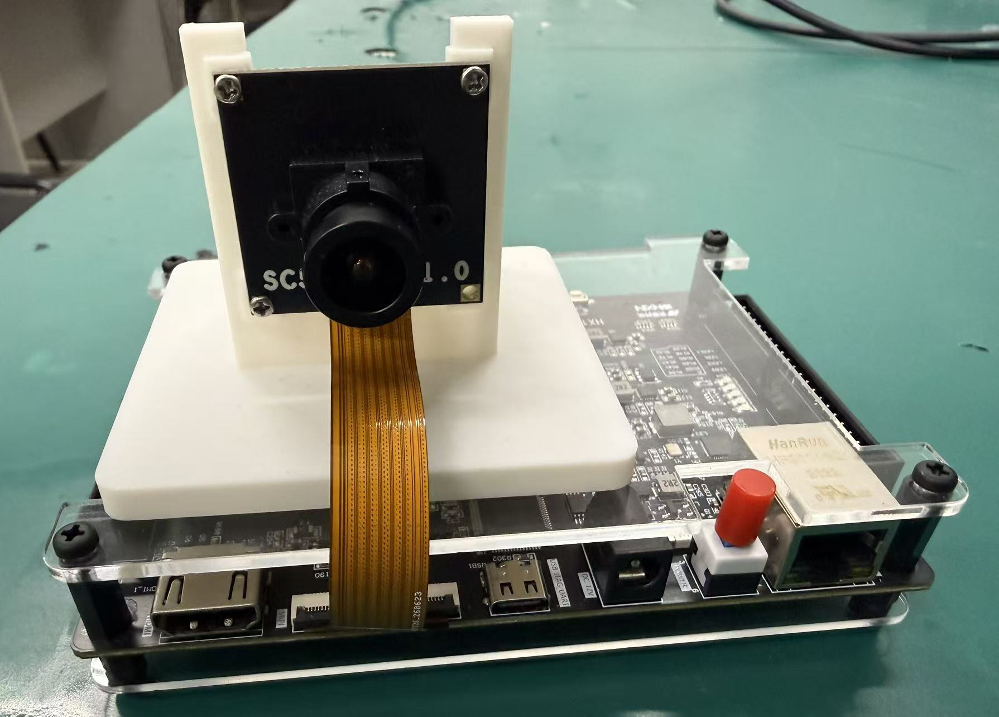
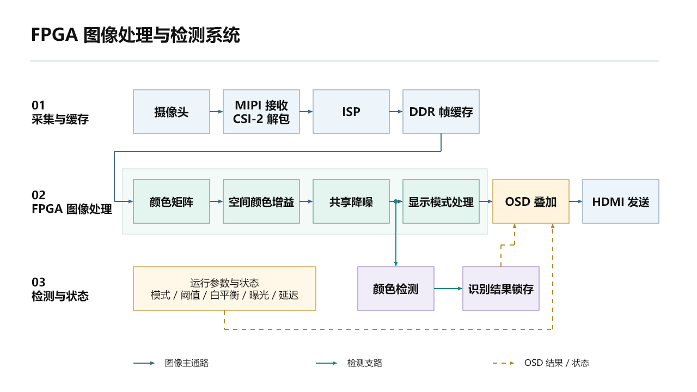

# 基于安路 PH1P35 的实时数字图像处理系统

本项目面向工业视觉与嵌入式图像处理应用，基于 HX1P35A 开发板与安路 PH1P35MDG324 FPGA，实现从 SC520CS 摄像头采集、图像质量调节、红黄绿颜色目标识别到 HDMI 显示的完整硬件处理链路。系统主体采用 RTL 实现，运行时无需 PC 参与图像处理。

本仓库用于全国大学生嵌入式芯片与系统设计竞赛 FPGA 创新设计赛道安路选题二的工程展示与复现，包含完整工程输入、仿真脚本、约束、对应位流及构建报告。



## 系统功能

| 功能 | 实现内容 |
| --- | --- |
| 视频采集与显示 | SC520CS 双通道 MIPI RAW10 输入，经 CSI-2 解包、ISP、DDR 帧缓存后输出 1280 × 720 HDMI 视频 |
| 多模式图像处理 | 彩色、灰度、Sobel 边缘、二值化、卡通风格化、YCbCr 色度诊断六种显示模式 |
| 颜色目标检测 | 红、黄、绿颜色分割，结合连通域、面积与边界框筛选，叠加多目标框及颜色信息 |
| 成像质量调节 | 自动曝光、局部高光保护、曝光锁定、自动白平衡及冻结、CCM 颜色矩阵与空间颜色增益 |
| 共享降噪 | RGB 各通道 3 × 3 中值与高斯混合处理，为检测与显示提供共同的质量图像 |
| 交互与观察 | 按键切换、拨码控制、OSD 状态显示、九点 RGB 观测及板内链路计时 |

## 系统架构



摄像头数据经过输入接收、ISP 与 DDR 缓存进入显示像素域，再依次进行颜色矩阵、空间增益与共享降噪。检测分支在显示模式处理之前读取质量图像，使颜色检测与显示模式切换相互独立。图像、有效标志、帧行标志及坐标同步传递，供 OSD 与目标框对齐。

多模式处理复用 5 × 5 空间窗口与行缓存，检测采用低位宽颜色标签与处理单元复用，以控制片上存储和运算资源开销。

## 硬件与开发环境

| 项目 | 配置 |
| --- | --- |
| 开发板 / FPGA | HX1P35A / PH1P35MDG324，Speed Grade 3 |
| 摄像头 | SC520CS，双通道 MIPI RAW10 |
| 视频输出 | HDMI，1280 × 720，60 Hz 显示输出 |
| 综合与实现 | 安路 TangDynasty 6.2，归档报告版本 v6.2.168116 |
| 仿真 | ModelSim；仓库提供 Tcl 脚本及测试输入 |
| 辅助脚本 | Python 3.9 或以上 |

60 Hz 为显示输出刷新率，摄像头采集与显示之间通过 DDR 进行缓存和速率匹配。

## 资源与时序

以下数据来自仓库所附 2026-10-27 布局布线报告，器件为 PH1P35MDG324，顶层为 `design_top_wrapper`。

| 资源 | 使用 / 总量 | 利用率 |
| --- | ---: | ---: |
| Slice | 17,550 / 21,216 | 82.72% |
| LUT6 | 16,673 / 21,216 | 78.59% |
| Slice Register | 17,960 / 42,432 | 42.33% |
| ERAM | 64 / 108 | 59.26% |
| DSP | 35 / 40 | 87.50% |

已约束路径的 Setup WNS 为 **+0.101 ns**，Hold WNS 为 **+0.020 ns**，Setup/Hold 总负裕量均为 0；报告记录的 STA 覆盖率为 **95.39%**。资源与时序结果可分别查阅[资源报告](reports/resource_utilization.area)、[最终时序报告](reports/final_timing.rpt)和[约束检查报告](reports/design_top_wrapper_route.check_timing)。

## 工程目录

```text
src/                 RTL、仿真测试平台、初始化数据与压缩测试输入
prj/scripts/         ModelSim 仿真、TD 构建及辅助脚本
prj/td/              TD 工程、平台源文件、IP 与 ADC/SDC 约束
bit/                 对应工程归档位流
reports/             布局布线资源、时序及约束检查报告
docs/                复现、验证与第三方组件说明
prepare_project.py   本机工程路径配置与仿真输入恢复
SHA256SUMS.txt        发布文件 SHA-256 校验清单
```

## 快速开始

1. 克隆仓库，并安装 TangDynasty 6.2 与 Python 3.9 或以上。
2. 在工程根目录执行 `python prepare_project.py --td-home D:/TD_6.2.1`，将参数替换为实际 TD 安装目录。脚本会配置本机路径、检查工程输入并恢复仿真数据。
3. 使用 TD 打开 `prj/td/lab_ex3_sc520/td_project/camera_to_dsi_display.al`，检查器件、约束与文件加载情况后进行综合及布局布线。
4. 使用对应开发板的下载工具加载 `bit/camera_to_dsi_display.bit`，连接摄像头与 HDMI 显示器，进行板上功能检查。

详细命令、仿真入口与硬件复现步骤见[工程复现说明](docs/reproduction.md)。

## 板上操作

| 控件 | 操作 |
| --- | --- |
| KEY1 | 切换显示模式 |
| KEY2 | 调节二值化阈值 |
| SW1 | 上拨启用降噪，下拨关闭 |
| SW2 | 上拨锁定曝光，下拨自动曝光 |
| SW3 | 上拨冻结白平衡，下拨自动白平衡 |
| SW4 | 切换九点 RGB 观测面板 |

具体拨动方向以 HX1P35A 板卡安装方向及屏幕 OSD 状态为准。

## 验证资料

仓库附有实物照片、模块仿真脚本、可核对的构建报告及位流校验值。不同光照下的识别率、连续帧漏检率等应用级对比数据尚待补充，不据此宣称定量改善幅度。验证范围与测试记录要求见[验证说明](docs/verification.md)。

平台接口、器件 IP 及第三方文件保留原有版权声明，使用边界见[第三方组件说明](docs/third-party.md)。
