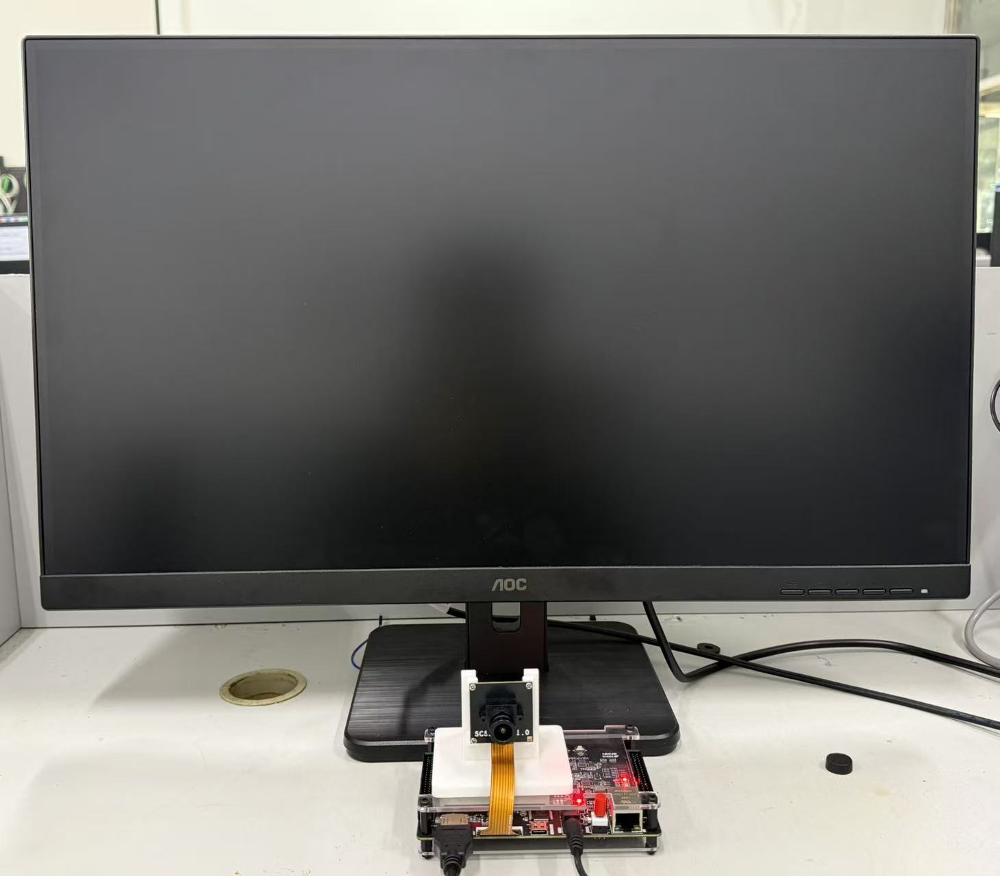

# 验证说明

## 证据与范围

| 验证对象 | 仓库证据 | 范围 |
| --- | --- | --- |
| 工程输入 | `.al` 工程及全部被引用文件 | 路径配置脚本检查 89 个工程文件入口 |
| 模块行为 | `src/sim/`、`prj/scripts/` 与压缩输入 | 仿真用于模块算法、控制与同步关系检查 |
| 资源占用 | `reports/resource_utilization.area` | 2026-10-27 PH1P35MDG324 布局布线结果 |
| 静态时序 | `reports/final_timing.rpt` | 已约束路径 Setup/Hold 余量为正，STA 覆盖率 95.39% |
| 约束完整性 | `reports/design_top_wrapper_route.check_timing` | 原始检查报告保留无输入/输出延迟等条目，不能将已约束路径通过等同于全部接口已完成约束 |
| 位流一致性 | `bit/` 与 `SHA256SUMS.txt` | 固定归档位流及其校验值 |
| 硬件形态 | 实物装配与系统照片 | 展示实际硬件组成，不作为识别率或延迟测量证据 |

资源统计对应完整归档构建，不以模块仿真或估算替代。重新综合、修改器件或工具版本后，须使用新构建报告更新指标。仓库发布整理未重新进行整板测试或完整综合布线。

## 发布前复现检查

2026-11-03，在独立工作副本中完成路径配置，验证全部 89 个工程输入存在，并恢复、校验 238 个仿真输入文件。使用 ModelSim SE-64 10.1c 运行以下模块测试，均正常完成且退出状态为 0：

| 测试 | 检查结果 | 原始记录 |
| --- | --- | --- |
| 按键控制 | PASS，22 项检查 | [仿真记录](../reports/simulation/btn_ctrl.txt) |
| 共享降噪 | PASS，1,646 项检查，16 × 8 测试图像，3 次重启 | [仿真记录](../reports/simulation/shared_denoise.txt) |

上述检查验证打包后的路径可配置性及对应模块行为；共享降噪测试使用随工程提供的 ERAM 行为模型。

## 实物系统

## 应用级对比测试

下列测试的定量数据尚待补充。测试前记录照度或可复现的灯光设置、机位、目标尺寸、距离、背景、自动曝光与白平衡状态、软件版本及位流校验值。

| 应用场景 | 建议对照 | 待记录指标 |
| --- | --- | --- |
| 传送过程中的相邻颜色目标 | 异色目标分离、接近、接触及遮挡，保持速度和取景范围一致 | 每类目标检出率、目标合并/漏检次数、框稳定性与样本数 |
| 光照变化 | 明亮、常规、偏暗与局部高光条件；分别记录成像调节前后状态 | 各颜色召回率、误检率、收敛时间与连续帧漏检率 |
| 资源复用 | 在相同器件、约束及工具版本下比较独立窗口与共享窗口实现 | Slice、LUT6、寄存器、ERAM、DSP 及 Setup/Hold WNS |

颜色分割和连通域提取适用于具有可区分颜色区域的目标；同色接触目标、严重遮挡或颜色信息丢失的过曝/欠曝区域需要单独评估。

完成测试后应同时提供原始图像或视频、有效样本数量、判定规则与统计结果。准确率提升、低照度下限及优化前后资源降幅，需有同条件对照数据后再报告。
